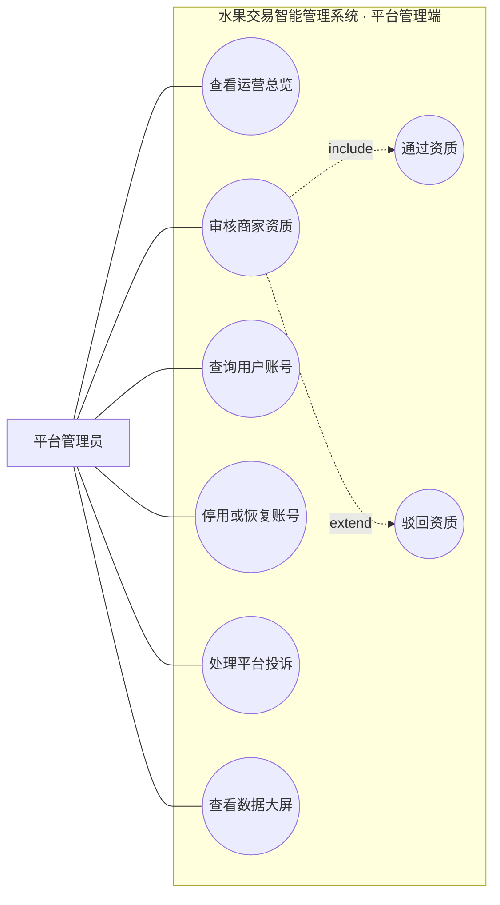
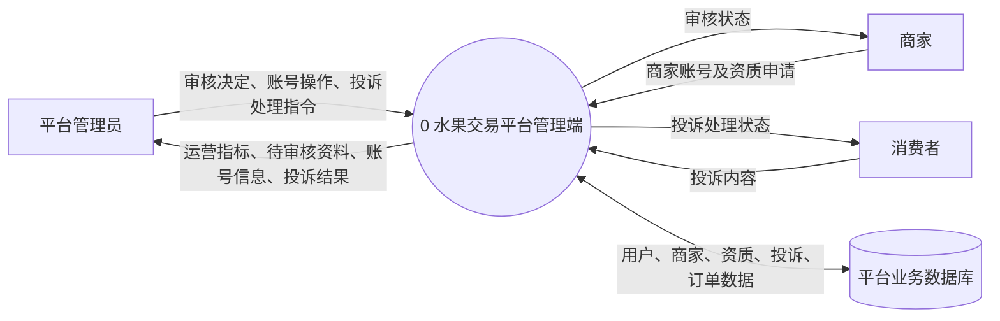
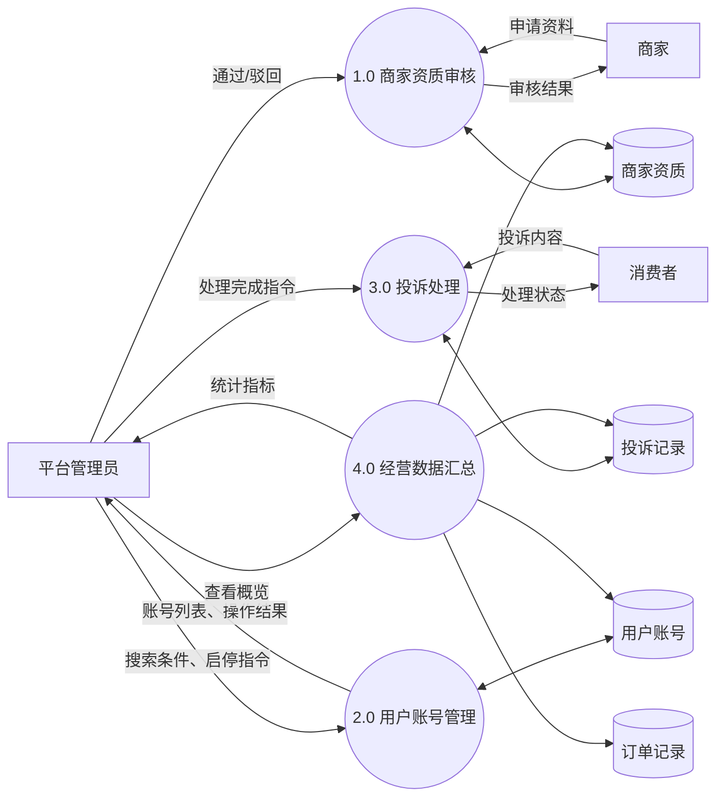
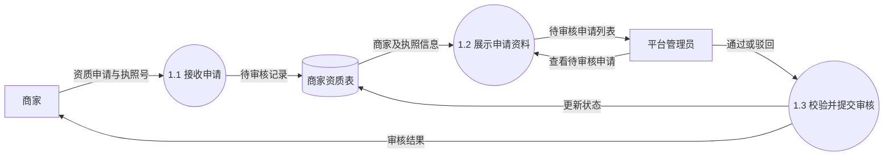
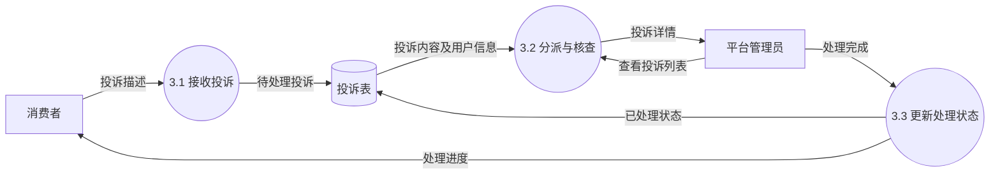
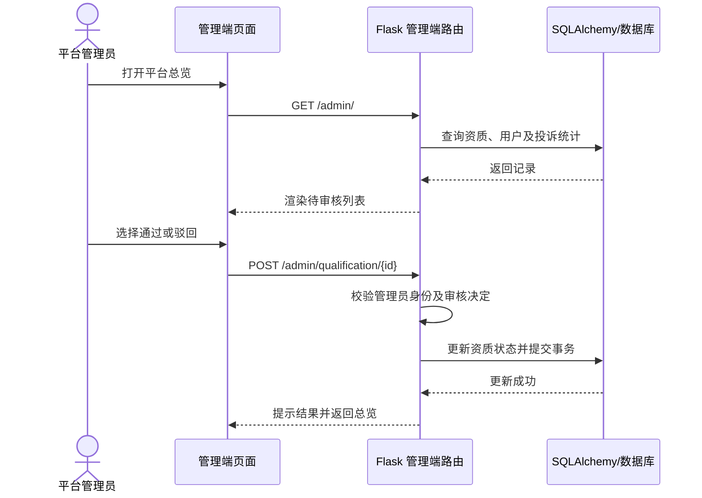
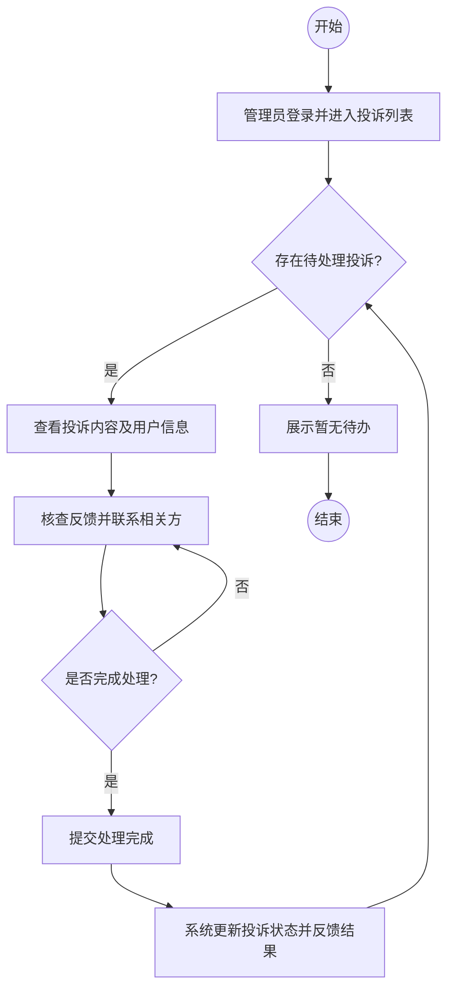
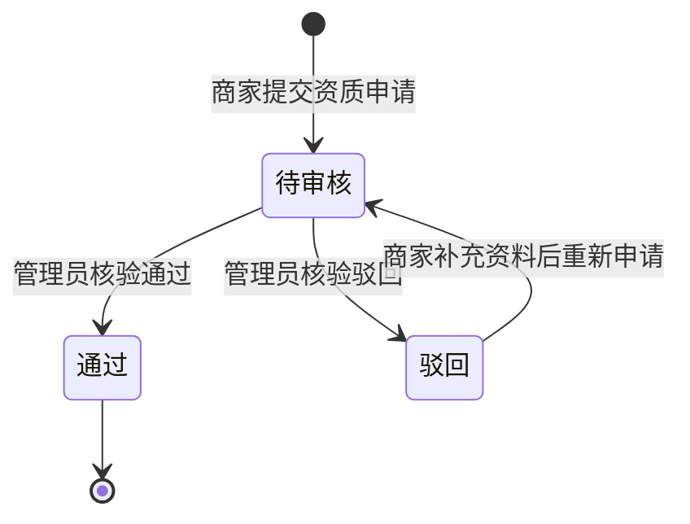

# 平台管理端 UML 核心模型

本文按《软件工程与 UML》实验一、实验三要求，围绕平台管理员的商家资质审核、用户账号管理和平台投诉处理展开。图使用 Mermaid 表达，可在支持 Mermaid 的 Markdown 查看器中直接渲染，也可导入 Mermaid Live Editor 导出图片。

## 需求陈述

平台管理员登录后可以查看运营概况；核验商家提交的营业执照并作出通过或驳回决定；检索用户及商家账号并执行停用或恢复；查看用户投诉并记录处理完成状态。系统应反馈操作结果，并保留资质和投诉的当前处理状态。数据大屏汇总用户数、商家数、订单数、待办数及履约订单金额。

## 用例图

## 0 层数据流图（上下文图）

## 1 层数据流图

## 2 层数据流图：商家资质审核

## 2 层数据流图：投诉处理

## 顺序图：审核商家资质

## 活动图：投诉处理

## 状态图：商家资质

## 设计说明

- 资质审核只允许管理员提交“通过/驳回”，由数据库状态记录审核结果，页面提供即时操作反馈。
- 投诉处理将工单从“待处理”更新为“已处理”，并在总览和全部投诉列表复用同一记录。
- 用户账号列表支持用户名、昵称、手机号检索。当前共享 `User` 模型没有账号状态字段，因此本实现的停用/恢复状态暂存于管理员会话；要实现跨会话、跨管理员持久化，需在团队确认后给共享用户模型增加状态列。
- 项目当前资质表只存商家 ID、执照号和状态；图中申请资料以现有字段为边界，没有虚构证照图片或审核日志实体。
- 数据大屏的订单金额由订单表现有金额与状态实时汇总，不引入单独的统计库。
